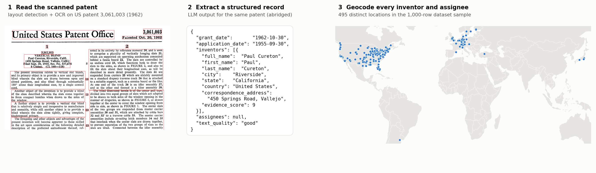

# Digitizing US patents, 1945–1980

I built an LLM-pipeline that has turned 1.8 million scanned historical US patents into a geocoded dataset of their inventors and assignees. Starting from the original document scan, the LLM extracts relevant information from its text, which is then assessed and standardized into a usable, geocoded dataset. The figure below follows one patent from scan to structured record; the map shows the geocoded locations of all inventors and assignees in the [dataset sample](#dataset-sample).



## Why

Why do some cities keep producing specialized technologies while others fall behind? How do institutional context and co-inventor characteristics change the process of invention? How does inventive activity cluster in space, and how do technological developments spread across regions? Answering these and many other questions in evolutionary economic geography and related fields needs long-run data on where inventions were made, by whom and when. US patents record exactly that, but for 1945–1980, no complete dataset exists: structured patent data from official sources only start in 1976, and earlier reconstructions are incomplete and unreliable for patents with several inventors. This project aims to close this gap. Together with an existing digitization of 1850–1945, it aims to provide the full history of US invention in one structured dataset.

## What it is for

- **Evidence for place-based innovation policy.** Governments try to build up new technologies and industries in specific regions (e.g. the EU's Smart Specialisation strategies). Long-run data show how regions actually acquired new technological capabilities, and what they built on.
- **A first result.** My master's thesis used an early version of the pipeline (20% of utility patents from 1945-1980) to study the development of Information and Communication Technology (ICT) in the US. US cities entered ICT along paths related to their existing technologies, and this constraint did not fade as ICT matured: new technologies grow out of local capabilities.
- **How invention is organized.** The data trace the shift from lone inventors to teams and corporate research labs, a question studied at the Complexity Science Hub ([Hartog et al., 2024](https://csh.ac.at/publication/inventing-modern-invention-the-professionalization-of-technological-progress-in-the-us/)).
- **Affordable digitization of historical archives.** The LLM extraction reaches F1 ≈ 0.96 at about €380 per million patents, and the approaches used carry over to other projects for digitizing historical records.

## What it does

The input is the USPTO's archive of scanned patent grants for 1945–1980: 105 archive files of about 10 GB each, [publicly available from the USPTO](https://data.uspto.gov/bulkdata/datasets/ptgrmp2?fileDataFromDate=1944-05-01&fileDataToDate=1981-03-01). For each patent, the pipeline:

1. **Reads the scan.** It finds the title page, detects the page layout (YOLOX) and runs OCR (DocTR) on the bibliographic block only.
2. **Extracts a structured record** with an LLM (gpt-oss-20b): grant and application date, every inventor and assignee, and their addresses split into fields, adapting autonomously to edge cases (e.g. deceased inventors, correspondence addresses).
3. **Geocodes every address** (US Census gazetteers, OpenStreetMap) and links US towns to official Census codes.
4. **Scores each record** with a confidence estimate (preliminary).

To arrive at this setup, I prototyped and benchmarked several LLM pipelines built with agentic frameworks and tools (reflection agents, ReAct framework, LangGraph workflow) against hand-labelled patents, looking for the most cost-effective one that met the performance targets. Vision language models (VLMs) reading the scans directly were tested too, but OCR followed by a text LLM performed well enough at a fraction of the cost.

| | |
|---|---|
| Source scans | ~1 TB (105 USPTO bulk archives) |
| Patents processed | 1.81 million (granted 1945–1980) |
| Inventor and assignee records | 4.0 million |
| Inventor records with a city | 97.7% |

## Dataset sample

[`digitized_patents_sample_1945_1980.csv`](digitized_patents_sample_1945_1980.csv): 1,002 inventor and assignee records from 494 patents, a demonstration sample stratified by grant year. Each record carries a preliminary confidence score (0–1) from a model trained on 921 hand-checked patents (cross-validated AUCs 0.90–0.98), which is under final review.

<details>
<summary>Show all 27 columns</summary>

| Column | Description |
|---|---|
| `patent_number` | USPTO patent number |
| `grant_date`, `grant_year` | Grant date (YYYY-MM-DD) and year |
| `application_date` | Application (filing) date |
| `entity_type` | `inventor` or `assignee` |
| `entity_sequence` | Position of the inventor/assignee on the patent |
| `full_name` | Name of the entity as printed on the patent |
| `first_name`, `middle_name`, `last_name`, `suffix` | Name parts (persons only) |
| `street`, `neighbourhood`, `city`, `county`, `state`, `subdivision`, `postal_code`, `country` | Address as printed on the patent, split into fields (empty if not printed) |
| `lat`, `lon` | Geocoded coordinates |
| `geocode_level`, `geocode_source` | Resolution of the coordinates; source (`Census` gazetteer or `Nominatim`/OpenStreetMap) |
| `fips` | US Census code of the town (7-digit place or 10-digit county subdivision); US only |
| `iso_country` | ISO 3166-1 country code |
| `confidence_score` | Estimated probability that this inventor/assignee record is correct (0–1, preliminary) |
| `confidence_score_dates` | Estimated probability that the patent's dates are correct (0–1, preliminary) |

</details>

## In this repository

- **[`digitized_patents_sample_1945_1980.csv`](digitized_patents_sample_1945_1980.csv)**: the dataset sample described above.
- **[`demo/`](demo/)**: the pipeline run on 5 example patents. The results are already included, since rerunning the extraction step requires an API key: [`demo/output/<patent>/`](demo/output/03061003/) shows each stage, from the detected layout to the OCR text to the extracted record.
- **[`pipeline/`](pipeline/)**: the OCR script used for the full production run, the model setup, and the extraction prompt.

## Run the demo

Not needed to see the results, which are already in `demo/output/`. To rerun it yourself: the OCR step runs locally; the extraction step calls the LLM through Groq's API and needs your own Groq API key.

```bash
pip install -r requirements.txt          # Python 3.10; also needs Tesseract and Poppler
python pipeline/setup_models.py          # one-time download of the layout and OCR models
python demo/1_run_ocr.py                 # scan -> OCR text
GROQ_API_KEY=... python demo/2_run_extraction.py   # OCR text -> structured record
```

## Context

This repository is a curated showcase of a project at the Complexity Science Hub worked on as part of my master's thesis. A data paper is in preparation. The full code (including geocoding and confidence scoring) and the dataset will be released with it.
